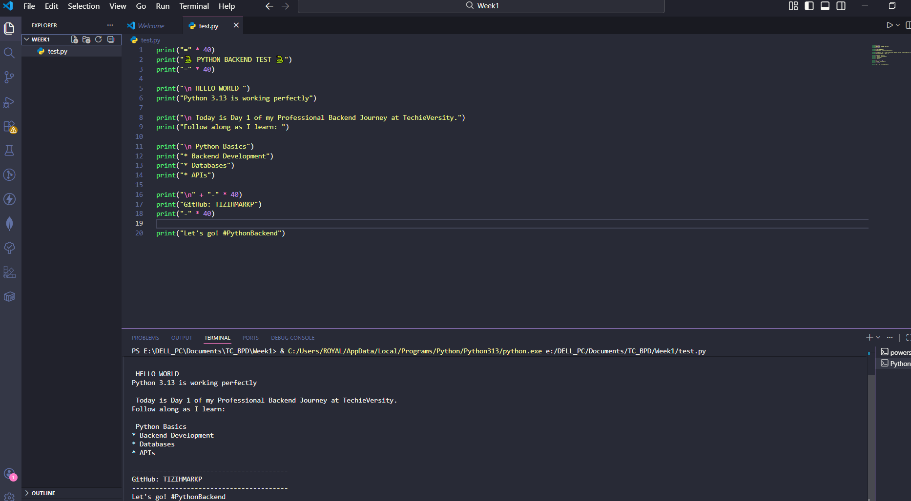
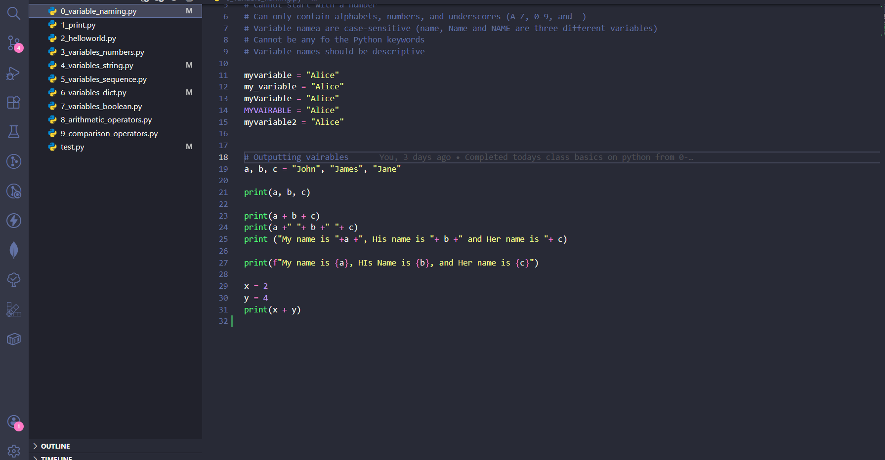
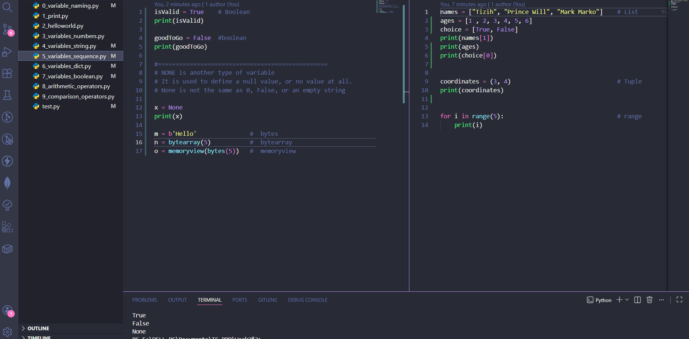
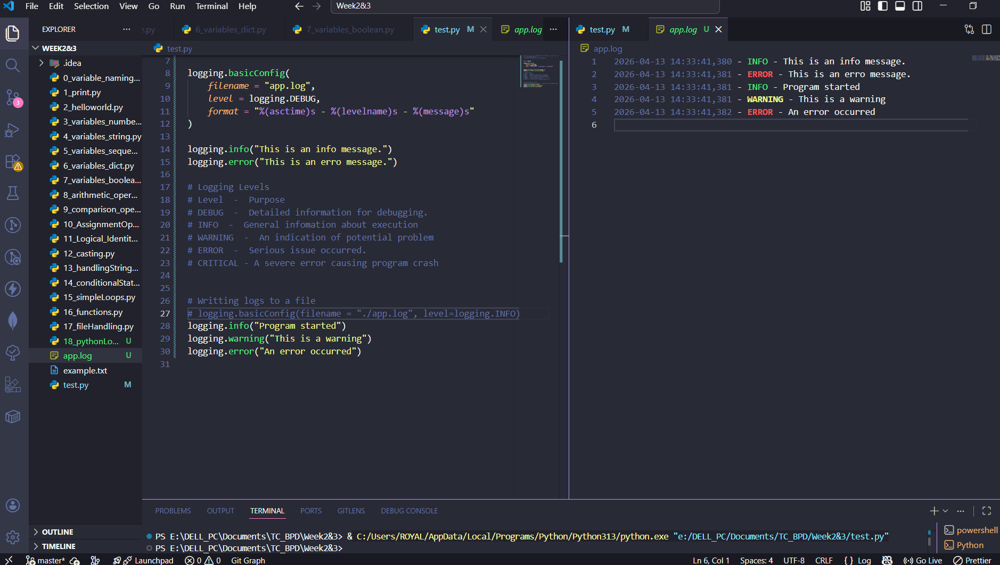

# Python Basics: My TC Backend Development Foundation With 🐍


## Welcome to my **Python Beginners TC_BPD Repository**

**One giant leap into backend development.**

During my learning at TC, I dedicated myself to mastering the fundamentals of Python—the language that powers some of the world's most robust backend systems. This project documents everything I learned during my backend development at TC, where I spent over 2 months mastering the foundation of Python. It has set a solid foundation that I'm now taking forward into Python Backend.

This repository is a **time capsule** of everything I learned: clean code, working examples, and the confidence to build real applications.

## Here's a snapshot of the concepts I explored and coded:

### Core Building Blocks
| Concept | What I Built |
|--------|--------------|
| **Variables, Strings & Numbers** | Basic data handling and manipulation |
| **Getting Input** | Interactive terminal programs |
| **Lists & List Methods** | Organized data structures with `.append()`, `.remove()`, and more |
| **Tuples** | Immutable sequences for fixed data |
| **2D Lists** | Grid-like data structures |
| **Dictionaries** | Key-value pairs for real-world data mapping |
| **Casting** | Converting one datatype to another |

### Logic & Control Flow
| Concept | What I Built |
|--------|--------------|
| **If Statements** | Decision-making logic |
| **Loops (for/while)** | Repetitive tasks made efficient |
| **Even Number Program** | Practical condition + loop combination |

### Functions & Error Handling
| Concept | What I Built |
|--------|--------------|
| **Functions & `return`** | Reusable, modular code |
| **Try/Except Blocks** | Bulletproof programs that don't crash |

### File Handling & OOP
| Concept | What I Built |
|--------|--------------|
| **Reading & Creating Files** | Persistent data storage |
| **Python Logging** | Provides a flexible way to log messages |
| **Module** | Reusing and extending functionality |

### Real-World Projects
| Concept | What I Built |
|--------|--------------|
| **Simple Word Program** | String manipulation mini-app |
| **Basic Calculator** | Arithmetic operations with input validation |
| **Login & Signup Program** | Simple user authentication system |
| **Modules** | A file containing Python definitions |

### Utilities
- **Comments** — Documented code for clarity
- **Try/Except** — Robust error handling

## Why This Matters

Because backend development isn't just about knowing syntax—it's about understanding how pieces fit together. This learning gave me:

✅ **Confidence** to tackle Flask next  
✅ **Clean code habits** with comments and structure  
✅ **Practical Learning** that mirror real-world logic  
✅ **A GitHub portfolio** that shows my growth path  

Every folder in this repo represents a concept I practiced, broke, fixed, and understood. This isn't theory—it's hands-on learning.

### Repository Structure
python-basics-backend/
│
├── 01_print/
├── 04_Variables_string/
├── 06_variables_dict/
├── 07_varaibles_boolean/
├── 09_comparison_operators/
├── 11_logical_identity/
├── 12_casting/
├── 15_simpleLoops/
├── 17_fileHandling/
├── 18_pythonLogging/
├── 19_errorHandling/
├── 20_modules/
├── 21_packages/
│
└── README.md

## Program Outputs

### Hello World


### Comparison Operators


### Variables Sequence


### Python Logging


### How to Explore
1. Clone this repository:
```bash
git clone https://github.com/TIZIHMARKP/TC_python-backend_beginners.git
cd PYTHONBASICS
```

### What's Next
This foundation is now leading me into:

FLASK — Building full-stack web apps
REST APIs — Connecting backend to frontend
Databases — PostgreSQL with Django ORM

#### Repo By TIZIH MARK, today 28/04/2026
